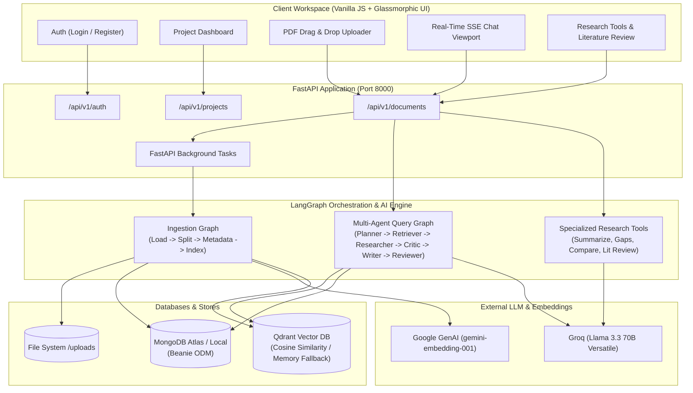
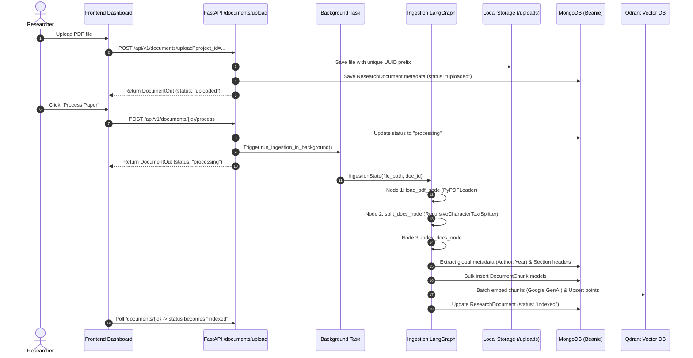
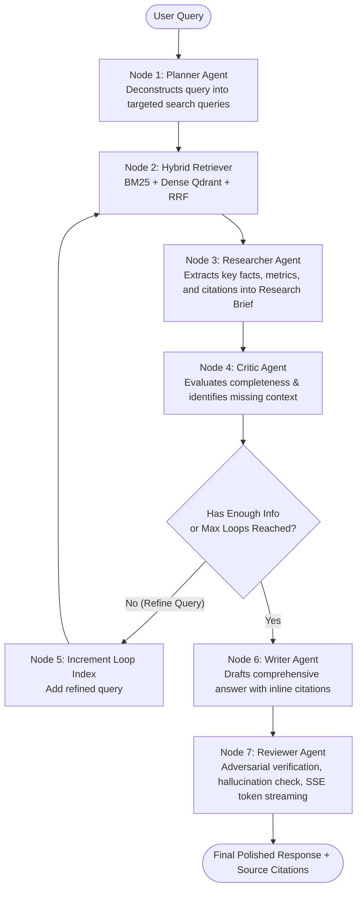
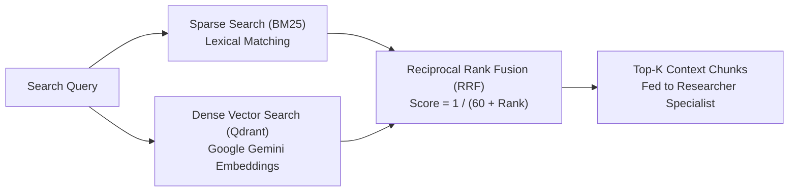

# 🧠 ResearchMind-AI

> **An Agentic Graph RAG Research Assistant & Academic Synthesis Platform**  
> Powered by LangGraph multi-agent orchestration, hybrid vector & lexical retrieval with reciprocal rank fusion, automated document ingestion, and deep academic synthesis tools.

---

## 📑 Table of Contents

- [Overview](#-overview)
- [Key Features](#-key-features)
- [System Architecture](#-system-architecture)
  - [High-Level Architecture](#high-level-architecture)
  - [Document Ingestion Workflow](#document-ingestion-workflow)
  - [Multi-Agent Query & Verification Graph](#multi-agent-query--verification-graph)
  - [Hybrid Retrieval & Reciprocal Rank Fusion Engine](#hybrid-retrieval--reciprocal-rank-fusion-engine)
- [Tech Stack](#-tech-stack)
- [Project Directory Structure](#-project-directory-structure)
- [Specialized Research Tools](#-specialized-research-tools)
- [Installation & Quickstart Guide](#-installation--quickstart-guide)
  - [Prerequisites](#prerequisites)
  - [1. Backend Setup](#1-backend-setup)
  - [2. Environment Variables Configuration](#2-environment-variables-configuration)
  - [3. Run the Backend](#3-run-the-backend)
  - [4. Run the Frontend](#4-run-the-frontend)
- [API Reference](#-api-reference)
  - [Authentication](#authentication)
  - [Projects](#projects)
  - [Documents & Processing](#documents--processing)
  - [Research Intelligence Tools](#research-intelligence-tools)
- [How to Use (Step-by-Step Walkthrough)](#-how-to-use-step-by-step-walkthrough)
- [Troubleshooting & FAQ](#-troubleshooting--faq)
- [Contributing & License](#-contributing--license)

---

## 🌟 Overview

Academic and scientific papers are dense, lengthy, and domain-complex. Traditional keyword search often misses semantic nuances, while naive Retrieval-Augmented Generation (RAG) suffers from hallucinations, incomplete context, lost metadata, and lack of synthesis across multiple documents.

**ResearchMind-AI** solves this by combining:
1. **Multi-Agent Orchestration**: A graph of specialized AI agents (Planner, Retriever, Researcher, Critic, Writer, and Reviewer) that critique and refine information retrieval in closed feedback loops.
2. **Hybrid Search with Reciprocal Rank Fusion**: Dense semantic vector embeddings (Google Gemini) combined with sparse lexical search (BM25) fused via Reciprocal Rank Fusion (RRF).
3. **Structured Document Ingestion**: Automatic parsing of PDF papers, chunking with sliding overlaps, dynamic section header detection (*Abstract*, *Methodology*, *Results*, etc.), and author/publication year extraction.
4. **Research Intelligence Tools**: Instant academic summarization, limitation & research gap extraction, semantic paper recommendation, conceptual flashcard creation, chronological timeline generation, cross-paper comparison, and project-wide thematic literature reviews.
5. **Real-Time Token Streaming**: Server-Sent Events (SSE) streaming with live feedback on which specialist agent is currently active.
6. **Hallucination Prevention & Verifiable Citations**: Every answer is verified by an adversarial reviewer agent and cited inline with `(Source: [Paper Name] Page [Page Number])`.

---

## ⚡ Key Features

- **🔐 Multi-Tenant Workspace & Auth**: Secure JWT-based authentication (OAuth2) with password hashing (Bcrypt) and strict user isolation for projects and documents.
- **📁 Organized Research Projects**: Group papers by topic, domain, or thesis subject with custom tags and descriptions.
- **📄 Smart PDF Ingestion Pipeline**: Asynchronous background document parsing with `PyPDF`, `RecursiveCharacterTextSplitter`, regex-driven section detection, and automated publication year/author metadata extraction.
- **🔍 Hybrid Retrieval with RRF**:
  - Dense Vector Search: `Qdrant` vector database with Google Generative AI embeddings (`gemini-embedding-001`).
  - Sparse Lexical Search: Dynamic `BM25` fitted per-document.
  - Fusion: Reciprocal Rank Fusion algorithm ($RRF = \sum \frac{1}{60 + \text{rank}}$).
- **🤖 Collaborative Multi-Agent Graph (LangGraph)**:
  - **Planner Agent**: Decomposes ambiguous questions into targeted retrieval sub-queries.
  - **Retriever Agent**: Executes hybrid search across indexed chunks.
  - **Researcher Agent**: Synthesizes structured research notes from extracted context.
  - **Critic Agent**: Audits notes for completeness and triggers iterative retrieval loops if gaps exist.
  - **Writer Agent**: Composes a rigorous academic response with inline source citations.
  - **Reviewer Agent**: Polishes output, eliminates hallucinations, checks citation fidelity, and streams the verified tokens.
- **🛠️ Academic Intelligence Suite**:
  - 📝 **Paper Summarizer**: Executive summary, methodology, key findings, and implications.
  - 🔬 **Research Gap Identifier**: Methodological limitations, assumptions, and proposed follow-up research proposals.
  - 🧭 **Literature Exploration Guide**: Targeted arXiv/Google Scholar query strings, theoretical frameworks, and seminal authors/labs.
  - 📇 **Conceptual Flashcard Generator**: Interactive Q&A study cards for algorithms and terminology.
  - 📅 **Timeline Extractor**: Chronological history of milestones and breakthroughs.
  - ⚖️ **Cross-Paper Comparison**: Side-by-side contrast of methods, shared themes, and conflicting findings between two papers.
  - 📚 **Project-Wide Literature Review**: Thematic multi-paper literature synthesis across all indexed papers in a project.
- **🎨 Glassmorphic Dark UI**: Modern responsive dashboard with glowing accents, animated loading spinners, progress indicators, interactive tabs, and full Markdown rendering.

---

## 🏗️ System Architecture

### High-Level Architecture



---

### Document Ingestion Workflow



---

### Multi-Agent Query & Verification Graph

When a user submits a question, a stateful LangGraph coordinates a pipeline of specialized agents:



---

### Hybrid Retrieval & Reciprocal Rank Fusion Engine



---

## 💻 Tech Stack

### Backend
| Component | Technology | Description |
| :--- | :--- | :--- |
| **Framework** | **FastAPI** (`>=0.110.0`) | High-performance asynchronous REST API framework |
| **Server Engine** | **Uvicorn** (`>=0.28.0`) | Lightning-fast ASGI server |
| **Agent Orchestration** | **LangGraph** (`>=0.0.26`) | Cyclic graph-based multi-agent state machines |
| **RAG Core** | **LangChain** (`>=0.1.0`) | LLM chains, loaders, and retriever abstractions |
| **Primary LLM** | **Groq Cloud** (`openai/gpt-oss-120b`) | Ultra-fast inference for planner, critic, writer, and tools |
| **Embeddings** | **Google Generative AI** (`models/gemini-embedding-001`) | High-fidelity 3072-dimensional text embeddings |
| **Vector Database** | **Qdrant** (`qdrant-client>=1.8.0`) | Semantic vector search with automated in-memory dev fallback |
| **Database & ODM** | **MongoDB** + **Beanie** (`>=2.0.0`) | Async MongoDB ODM backed by Motor & Pydantic v2 |
| **Document Parsing** | **pypdf** (`>=4.1.0`) | Text extraction, section parsing, and creation date detection |
| **Lexical Search** | **rank-bm25** (`>=0.2.2`) | BM25 Okapi algorithm for keyword-specific retrieval |
| **Security & Auth** | **PyJWT** & **Bcrypt** | JSON Web Tokens with password hashing |
| **Settings Management**| **pydantic-settings** | Type-safe environment variable management |

### Frontend
| Component | Technology | Description |
| :--- | :--- | :--- |
| **Core** | **HTML5 & Vanilla JavaScript (ES6+)** | Zero-framework footprint, fast load times, native DOM manipulation |
| **Styling** | **Vanilla CSS3** | Custom glassmorphism, responsive grid, tailored dark palette, and CSS variables |
| **Streaming** | **Server-Sent Events (SSE)** | Real-time token streaming with live agent status updates |
| **Typography** | **Google Fonts** | `Inter` (body copy) & `Outfit` (display headers) |
| **Icons** | **FontAwesome 6** | Modern iconography across dashboard, status badges, and buttons |

---

## 📂 Project Directory Structure

```text
ResearchMind-AI/
├── backend/
│   ├── app/
│   │   ├── api/                     # FastAPI route handlers
│   │   │   ├── auth.py              # User registration, login, and profile endpoints
│   │   │   ├── deps.py              # JWT authentication dependency injection
│   │   │   ├── documents.py         # Upload, processing, query SSE, and research tools
│   │   │   └── projects.py          # Project management CRUD
│   │   ├── config/
│   │   │   └── settings.py          # Pydantic BaseSettings loading from .env
│   │   ├── core/
│   │   │   └── security.py          # Bcrypt hashing and JWT token creation/validation
│   │   ├── database/
│   │   │   └── mongodb.py           # Async Motor client and Beanie ODM initialization
│   │   ├── models/                  # Beanie Document models (MongoDB collections)
│   │   │   ├── chunk.py             # DocumentChunk model (text, page, section, year)
│   │   │   ├── document.py          # ResearchDocument model (file path, status, size)
│   │   │   ├── project.py           # ResearchProject model (title, description, tags)
│   │   │   └── user.py              # User model (email, hashed password, active state)
│   │   ├── rag/                     # RAG & Multi-Agent orchestration
│   │   │   ├── chains/              # Helper prompt formatters
│   │   │   ├── embeddings/          # Google Gemini embedding provider
│   │   │   ├── graph/               # LangGraph state machine definitions
│   │   │   │   ├── ingestion.py     # Document ingestion graph (PDF -> chunks -> index)
│   │   │   │   ├── query_graph.py   # Multi-agent specialists graph with SSE streaming
│   │   │   │   └── state.py         # TypedDict graph states
│   │   │   ├── loaders/             # PDF document loader using PyPDFLoader
│   │   │   ├── retrievers/          # HybridRetriever (BM25 + Qdrant + RRF)
│   │   │   ├── splitters/           # RecursiveCharacterTextSplitter configuration
│   │   │   └── tools/               # Research tool agents (summary, gaps, lit review, etc.)
│   │   ├── schemas/                 # Pydantic request/response schemas
│   │   │   ├── document.py          # DocumentOut schema
│   │   │   ├── project.py           # ProjectCreate and ProjectUpdate schemas
│   │   │   ├── query.py             # QueryRequest and QueryResponse schemas
│   │   │   └── user.py              # UserCreate, UserOut, and Token schemas
│   │   ├── utils/
│   │   │   └── metadata.py          # PDF header detection & section classifier
│   │   └── main.py                  # FastAPI application entrypoint with CORS & routes
│   │
│   ├── uploads/                     # Storage directory for uploaded PDF documents
│   ├── .env.example                 # Example configuration template
│   ├── requirements.txt             # Backend Python dependencies
│   ├── run_server.py                # Server runner script
│   └── README.md                    # Backend-specific quickstart guide
│
├── frontend/
│   ├── index.html                   # Single-page application structure & modals
│   ├── style.css                    # Glassmorphism design system & micro-animations
│   └── app.js                       # Frontend client logic, API bindings, and SSE handlers
│
├── .gitignore                       # Git exclusion rules
└── README.md                        # Master repository documentation (this file)
```

---

## 🛠️ Specialized Research Tools

The application features 7 tailored academic research tools:

| Tool | Endpoint | Scope | Purpose |
| :--- | :--- | :--- | :--- |
| **📄 Summarize Paper** | `POST /documents/{id}/tools/summarize` | Single Paper | Generates a 4-part academic synthesis: Executive Summary, Key Methodology, Main Findings, and Research Implications. |
| **🔍 Research Gaps** | `POST /documents/{id}/tools/gaps` | Single Paper | Targets limitations, assumptions, and conclusions to uncover unaddressed research questions and propose concrete extension studies. |
| **🧭 Paper Recommender** | `POST /documents/{id}/tools/recommend` | Single Paper | Extracts domain keywords, generates ready-to-use search strings for Google Scholar/arXiv, and highlights key theoretical frameworks. |
| **📇 Flashcard Generator** | `POST /documents/{id}/tools/flashcards` | Single Paper | Generates 5 high-yield conceptual flashcards (Question & Answer pairs) covering core terminology, algorithms, and models. |
| **📅 Timeline Extractor** | `POST /documents/{id}/tools/timeline` | Single Paper | Extracts chronological development milestones, historical context, and publication dates mentioned in the text. |
| **⚖️ Cross-Paper Comparison** | `POST /documents/{id}/tools/compare` | Two Papers | Compares two indexed papers side-by-side: common themes, methodological contrasts, and conflicting findings. |
| **📚 Literature Review** | `POST /documents/project/{id}/tools/literature-review` | Whole Project | Synthesizes all papers in a project into a thematic literature review: Introduction & Scope, Thematic Synthesis, and Open Challenges. |

---

## 🚀 Installation & Quickstart Guide

### Prerequisites
Make sure you have the following installed on your machine:
- **Python 3.10+** (Check via `python3 --version`)
- **MongoDB** (A local MongoDB instance or a free [MongoDB Atlas](https://www.mongodb.com/atlas) cluster)
- **API Keys**:
  - [Groq API Key](https://console.groq.com/) (Required for LLM inference)
  - [Google Gemini API Key](https://aistudio.google.com/) (Required for text embeddings)
- *(Optional)* **Qdrant**: If Qdrant is not running on port `6333`, the backend automatically falls back to an in-memory vector database.

---

### 1. Backend Setup

Open a terminal and navigate to the `backend` folder:

```bash
cd backend
```

Create and activate a Python virtual environment:

```bash
# macOS / Linux:
python3 -m venv venv
source venv/bin/activate

# Windows:
python -m venv venv
venv\Scripts\activate
```

Install the dependencies:

```bash
pip install --upgrade pip
pip install -r requirements.txt
```

---

### 2. Environment Variables Configuration

Create a `.env` file in the `backend/` directory by copying the example:

```bash
cp .env.example .env
```

Open `.env` in your text editor and fill in your values:

```env
# Application Settings
APP_NAME="ResearchMind-AI API"
DEBUG=true
API_V1_STR="/api/v1"
SECRET_KEY="replace-with-a-random-32-byte-secret-key"

# MongoDB Database Connection
MONGODB_URL="mongodb://localhost:27017" # Or your MongoDB Atlas connection string
MONGODB_DB_NAME="researchmind"

# LLM Providers
GROQ_API_KEY="your-groq-api-key-here"
GROQ_MODEL="openai/gpt-oss-120b"
GOOGLE_API_KEY="your-google-gemini-api-key-here"

# Vector Store Configuration
VECTOR_STORE_TYPE="qdrant"
QDRANT_URL="http://localhost:6333"
QDRANT_API_KEY=""
QDRANT_COLLECTION_NAME="researchmind_chunks"

# CORS Configuration
BACKEND_CORS_ORIGINS=["http://localhost:3000","http://127.0.0.1:3000","http://localhost:5500","http://127.0.0.1:5500"]
```

> [!TIP]
> **No Qdrant running?**  
> If you don't have Qdrant running locally, leave `QDRANT_URL="http://localhost:6333"`. The backend will automatically detect that port `6333` is unreachable and initialize a high-performance in-memory vector store!

---

### 3. Run the Backend

Run the server with Uvicorn:

```bash
uvicorn app.main:app --reload --port 8000
```

Or execute the provided runner script:

```bash
python run_server.py
```

Once running:
- **API Base**: [http://127.0.0.1:8000](http://127.0.0.1:8000)
- **Interactive Swagger Docs**: [http://127.0.0.1:8000/docs](http://127.0.0.1:8000/docs)
- **Interactive ReDoc**: [http://127.0.0.1:8000/redoc](http://127.0.0.1:8000/redoc)
- **Health Check**: [http://127.0.0.1:8000/health](http://127.0.0.1:8000/health)

---

### 4. Run the Frontend

The frontend is built with pure HTML5, CSS, and modern JavaScript, so it requires no build steps or `npm install`.

You can serve it using any local HTTP server:

#### Option A: Python Built-in Server
In a new terminal window:
```bash
cd frontend
python3 -m http.server 3000
```
Open [http://localhost:3000](http://localhost:3000) in your browser.

#### Option B: VS Code Live Server
Right-click `frontend/index.html` inside VS Code / Cursor and select **"Open with Live Server"** (runs on port 5500).

#### Option C: Node `serve` or `http-server`
```bash
npx serve frontend -p 3000
```

---

## 📡 API Reference

All API routes are prefixed by `/api/v1`. Protected routes require the header `Authorization: Bearer <token>`.

### Authentication
| Method | Endpoint | Description | Auth Required |
| :--- | :--- | :--- | :---: |
| `POST` | `/api/v1/auth/register` | Register a new user account (`email`, `password`) | No |
| `POST` | `/api/v1/auth/login` | Authenticate and obtain JWT access token (OAuth2 form) | No |
| `GET` | `/api/v1/auth/me` | Fetch currently logged in user profile | Yes |

### Projects
| Method | Endpoint | Description | Auth Required |
| :--- | :--- | :--- | :---: |
| `POST` | `/api/v1/projects/` | Create a new research project (`title`, `description`, `tags`) | Yes |
| `GET` | `/api/v1/projects/` | List all projects belonging to current user | Yes |
| `GET` | `/api/v1/projects/{id}` | Get project details by ID | Yes |
| `PUT` | `/api/v1/projects/{id}` | Update project title, description, or tags | Yes |
| `DELETE`| `/api/v1/projects/{id}` | Delete project | Yes |

### Documents & Processing
| Method | Endpoint | Description | Auth Required |
| :--- | :--- | :--- | :---: |
| `POST` | `/api/v1/documents/upload` | Upload a PDF document (`project_id`, `file`) | Yes |
| `GET` | `/api/v1/documents/project/{id}`| List all documents under a project | Yes |
| `GET` | `/api/v1/documents/{id}` | Get document metadata and status | Yes |
| `POST` | `/api/v1/documents/{id}/process`| Trigger background LangGraph ingestion & vector indexing | Yes |
| `DELETE`| `/api/v1/documents/{id}` | Delete PDF file, DB chunks, and Qdrant vectors | Yes |
| `POST` | `/api/v1/documents/{id}/query` | Stream multi-agent answer tokens & citations (SSE) | Yes |

### Research Intelligence Tools
| Method | Endpoint | Description | Auth Required |
| :--- | :--- | :--- | :---: |
| `POST` | `/api/v1/documents/{id}/tools/summarize` | Executive summary, methodology, and findings | Yes |
| `POST` | `/api/v1/documents/{id}/tools/gaps` | Limitations, assumptions, and proposed future research | Yes |
| `POST` | `/api/v1/documents/{id}/tools/recommend` | Semantic keyword recommendations & seminal labs | Yes |
| `POST` | `/api/v1/documents/{id}/tools/flashcards` | Formulates 5 educational study Q&A cards | Yes |
| `POST` | `/api/v1/documents/{id}/tools/timeline` | Extracts chronological historical timeline | Yes |
| `POST` | `/api/v1/documents/{id}/tools/compare?document_id_2={id2}` | Comparative report between two papers | Yes |
| `POST` | `/api/v1/documents/project/{id}/tools/literature-review` | Thematic literature review across entire project | Yes |

---

## 📖 How to Use (Step-by-Step Walkthrough)

### 1. Register & Log In
1. Open the application in your browser (`http://localhost:3000`).
2. Click **Create an account**, enter your email and password (minimum 6 characters), and submit.
3. Log in with your new credentials. Your session is securely stored via JWT in `localStorage`.

### 2. Create a Research Project
1. In the sidebar, click the **`+`** icon next to **Projects**.
2. Enter a project title (e.g., *"Transformers & Attention Mechanisms"*), an optional description, and tags (e.g., `NLP, Deep Learning`).
3. Click **Create Project**. The project will appear in your sidebar.

### 3. Upload & Index Research Papers
1. Click on your project from the sidebar.
2. In the **Documents** pane, drag and drop a PDF research paper into the upload box (or click to browse).
3. The file will upload to `/uploads` and appear in your document list with status `uploaded`.
4. Click the **Process Paper** button on the document card.
5. Watch the status transition to `processing` and then to `indexed` once chunking, section extraction, and vector embedding are complete.

### 4. Ask Questions with Multi-Agent Verification
1. Click the **💬 (Chat)** button next to an indexed document to activate it in the **Research Center**.
2. In the **Chat Q&A** tab, type any research question (e.g., *"What is the main bottleneck identified in the attention mechanism?"*).
3. Watch the live agent status updates as the **Planner**, **Retriever**, **Researcher**, **Critic**, **Writer**, and **Reviewer** agents execute.
4. Read the verified response streamed in real-time, complete with inline citations and expandable reference source snippets.

### 5. Run Research Tools
1. Switch to the **Document Tools** tab.
2. Click any tool card:
   - **Summarize Paper**: Read a structured 4-part summary.
   - **Find Research Gaps**: Uncover open problems and future directions.
   - **Recommend Papers**: Get exact search strings for arXiv and related frameworks.
   - **Generate Flashcards**: Review key definitions and equations.
   - **Timeline Extraction**: View chronological milestones.
3. Compare papers: Select another processed paper from the dropdown and click **Run Comparison**.

### 6. Generate a Project-Wide Literature Review
1. Switch to the **Project Synthesis** tab.
2. Click **Synthesize Literature Review**.
3. ResearchMind-AI analyzes the context across *all* indexed papers in the project and composes a thematic review synthesizing common themes, contrasting conclusions, and outlining open domain challenges.

---

## ❓ Troubleshooting & FAQ

### 1. `Local Qdrant server not detected on port 6333`
> **Answer**: This is completely normal and expected if you haven't started a standalone Qdrant instance. ResearchMind-AI has an automated fallback that initializes an in-memory Qdrant client (`location=":memory:"`), so all semantic search and embedding features will work without any extra setup!

### 2. `Only PDF files are supported.`
> **Answer**: Currently, document ingestion supports `.pdf` files. Ensure your file ends with `.pdf` and contains extractable text (non-scanned images).

### 3. `Document is already being processed.`
> **Answer**: Ingestion runs in the background. If a document is currently chunking and indexing, wait a few seconds and refresh or poll the status.

### 4. Rate Limiting on Google Gemini Embeddings
> **Answer**: Free-tier Google Gemini API keys may have requests-per-minute (RPM) limits. ResearchMind-AI automatically batches embeddings in chunks of 5 with an intentional 1.2-second pause between batches to prevent 429 quota exhaustion.

---

## 📄 Contributing & License

Contributions, feature requests, and bug reports are welcome!  
Feel free to open an issue or submit a pull request.

1. Fork the Project
2. Create your Feature Branch (`git checkout -b feature/AmazingFeature`)
3. Commit your Changes (`git commit -m 'Add some AmazingFeature'`)
4. Push to the Branch (`git push origin feature/AmazingFeature`)
5. Open a Pull Request

Distributed under the **MIT License**. See `LICENSE` for more information.

---

<p align="center">
  Built with ❤️ for researchers, academics, and curious minds.
</p>
